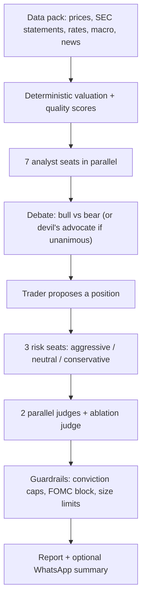

# finance-analysis-agent

A committee of AI analysts that researches a stock, ETF or gold and writes a report, built to run as a command inside [OpenClaw](https://github.com/openclaw/openclaw).

Message `analyze AAPL` (or run one shell command). About ten minutes later you get a full markdown report, plus an optional short WhatsApp summary.

> **Research only. Not financial advice.** The output is an educational second opinion, not a recommendation to trade. See [Limits](#honest-limits).

## What it does

The key rule is that **formulas do the math and the LLM only interprets the numbers.** Valuation, quality scores and technical signals are computed deterministically and are unit-tested. The LLM committee then reads the finished data pack. A citation check flags any number the committee quotes that isn't in the pack.



| Layer | What it gives you |
|---|---|
| **Macro scorecard** | 8 angles (policy path, liquidity, inflation, real yields, growth/recession, financial conditions, dollar, event calendar), each marked supportive / headwind / neutral for tech and for gold |
| **Valuation models** | Residual operating income, abnormal earnings growth, owner earnings, and a reverse DCF that shows what growth the price implies |
| **Quality overlay** | Piotroski F, Mohanram G, Altman Z, Beneish M, accruals, ROCE |
| **Own-history anchors** | Where today's multiples sit in the stock's own history (percentiles) |
| **Signal base rates** | How often golden/death cross, RSI and MACD signals actually paid off for this ticker, with confidence intervals |
| **7 analyst seats** | fundamental, valuation, technical, sentiment, Buffett lens, Burry lens, macro |
| **Honest-committee checks** | Two judges must agree or conviction is capped. An ablation judge decides without the dollar fair value. The decision includes an invalidation price. |
| **Track record** | `track_accuracy.py` scores past calls against real prices and compares a paper book with plain dollar-cost averaging |

Funds and gold have no company statements, so for them the valuation models and quality scores are n/a. The macro scorecard, technicals and base rates carry the analysis instead.

The full design, with every formula and the reasoning behind each choice, is in [docs/DESIGN.md](docs/DESIGN.md).

## Quick start (with OpenClaw)

You need a working OpenClaw install and Python 3.10+. For OpenClaw setup, see the [OpenClaw docs](https://docs.openclaw.ai).

**1. Clone and install**

```bash
git clone https://github.com/tiffanychum/finance-analysis-agent.git
cd finance-analysis-agent
python3 -m venv .venv
.venv/bin/pip install -r requirements.txt
```

**2. Configure a model provider**

```bash
cp .env.example .env
```

Edit `.env` and choose one provider:

| Provider | Set in `.env` | Notes |
|---|---|---|
| **Cursor** (default) | `LLM_PROVIDER=cursor`, `CURSOR_API_KEY=...` | Tested with Grok 4.7 Medium Fast. The only provider with live web-search lookups. |
| **Any OpenAI-compatible API** | `LLM_PROVIDER=openai`, `LLM_API_KEY`, `LLM_MODEL`, optional `LLM_BASE_URL` | Works with OpenAI, OpenRouter, Groq, Together, or a local Ollama or LM Studio server. |

Example for a local Ollama model:

```bash
LLM_PROVIDER=openai
LLM_MODEL=llama3.1
LLM_BASE_URL=http://localhost:11434/v1
```

Without Cursor, the analyst-consensus and fiscal-news web lookups are skipped. Those report fields show as unavailable, and the committee runs on the Yahoo and SEC data. The prompts and timeouts were tuned on Grok 4.7, so smaller models may produce weaker or less consistent debates. Treat other providers as experimental.

**3. Try it from the terminal** (no OpenClaw needed)

```bash
.venv/bin/python pipeline.py AAPL --no-whatsapp
```

The report is written to `reports/AAPL-<timestamp>.md`. A run takes about 8 to 15 minutes and makes 12 to 17 model calls.

**4. Teach your OpenClaw agent the command**

Open [openclaw/workspace-snippet.md](openclaw/workspace-snippet.md), replace `/path/to/finance-analysis-agent` with your clone path, and paste it into your OpenClaw workspace `AGENTS.md` (usually `~/.openclaw/workspace/AGENTS.md`).

Then message your agent on any connected channel:

| Message | What happens |
|---|---|
| `analyze AAPL` | 12-month committee analysis (about 8 to 15 min) |
| `analyze QQQ 6` | Same, with a 6-month holding period (1 to 60) |
| `macro` | Standalone macro regime scan with a tech-ETF and gold tilt (about 1 to 2 min) |
| `macro-backtest QQQ 12` | Replays the macro rules since 2006 against that ticker (about 20 s, no model calls) |

The launcher replies instantly and runs detached, because OpenClaw agent turns must not wait on a long job. Reports land in `reports/`.

**5. Optional: WhatsApp summary**

Link WhatsApp in OpenClaw (`openclaw channels login --channel whatsapp`), then set your number in `.env`:

```bash
FINANCE_AGENT_WHATSAPP_TO=+15551234567
```

Leave it blank to skip the message. The report is always saved.

**6. Optional: your portfolio**

```bash
cp portfolio.yaml.example portfolio.yaml
```

Edit it with your holdings. The trader and risk seats then consider concentration and any existing position. `portfolio.yaml` is gitignored.

## Reading a report

Each report starts with the decision, then the evidence:

```
FINAL: AVOID · conviction 70/100 · size 0.0% · horizon 12mo
Invalidation level: close below 108.01
Two judge runs: SELL / SELL (agree)
Ablation (no dollar fair value): SELL conviction 62 - same call
```

- **Invalidation level:** the price that would prove the call wrong. `track_accuracy.py` checks daily closes against it.
- **Two judge runs / Ablation:** if the judges disagree, or the call depends on the dollar fair value, conviction is capped at 50 and the report says so.
- **What changed since last run:** a diff against the previous report for the same ticker.
- **Macro scorecard:** the 8 angles in a table, with an impact label for the asset.
- **Valuation models, anchors, base rates, quality overlay:** the numbers the committee saw.
- **Debate and Trader and risk:** the full committee transcript.

To score past calls and compare a paper book against dollar-cost averaging:

```bash
.venv/bin/python track_accuracy.py
```

## Project layout

```
pipeline.py            orchestrator: pack -> committee -> report
agents_llm.py          LLM provider layer, seats, debate, judges
data.py                Yahoo / SEC / treasury data fetch
valuation.py           valuation models and quality scores
macro*.py              macro scorecard, tilt rules, historical backtest
guardrails.py          conviction caps and hard rules
anchors.py base_rates.py changes.py portfolio.py   model-free context
track_accuracy.py      scores past calls, paper book vs DCA
scripts/finance-agent.sh   detached launcher the OpenClaw agent calls
openclaw/              paste-in snippet for your agent's AGENTS.md
tests/                 337 unit tests (no network or API calls)
docs/DESIGN.md         full design note
```

## Tests

```bash
.venv/bin/python -m pytest -q
```

## Troubleshooting

| Symptom | Fix |
|---|---|
| WhatsApp message gets no reply | Check the gateway is up: `openclaw gateway status`. If WhatsApp reports "logged out", re-link with `openclaw channels login --channel whatsapp` and restart the gateway. |
| Reply says it's "already running" | A run for that ticker is in progress. Wait for it, or check `reports/.last-run-<TICKER>.log`. |
| Run died immediately | Read `reports/.last-run-<TICKER>.log` for the traceback. |
| `CURSOR_API_KEY not set` / `LLM_MODEL` error | Check `.env` is in the repo root and the variables for your chosen provider are filled in. |
| Many fields show n/a | Expected for ETFs and gold, which have no company statements. |

## Honest limits

- **Not advice.** It can be wrong, and LLM output varies from run to run.
- **The macro tilt is context, not a signal.** The included `macro-backtest` found that the tilt did not reliably predict QQQ or gold returns.
- **Data is free and imperfect.** It uses Yahoo, SEC filings, Treasury and FRED. Statements can be months stale, and the report prints how stale.
- **Web-searched figures are unverified.** Analyst consensus pulled by LLM web search is flagged as such in the report.
- **Cost and time.** Each ticker run makes 12 to 17 model calls, so check your provider's pricing.

## License

MIT. See [LICENSE](LICENSE).
