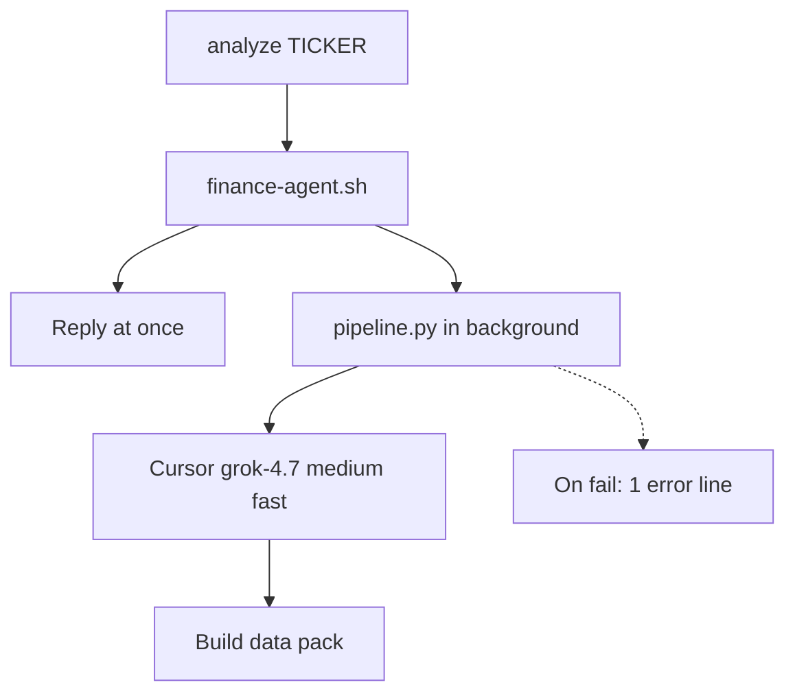
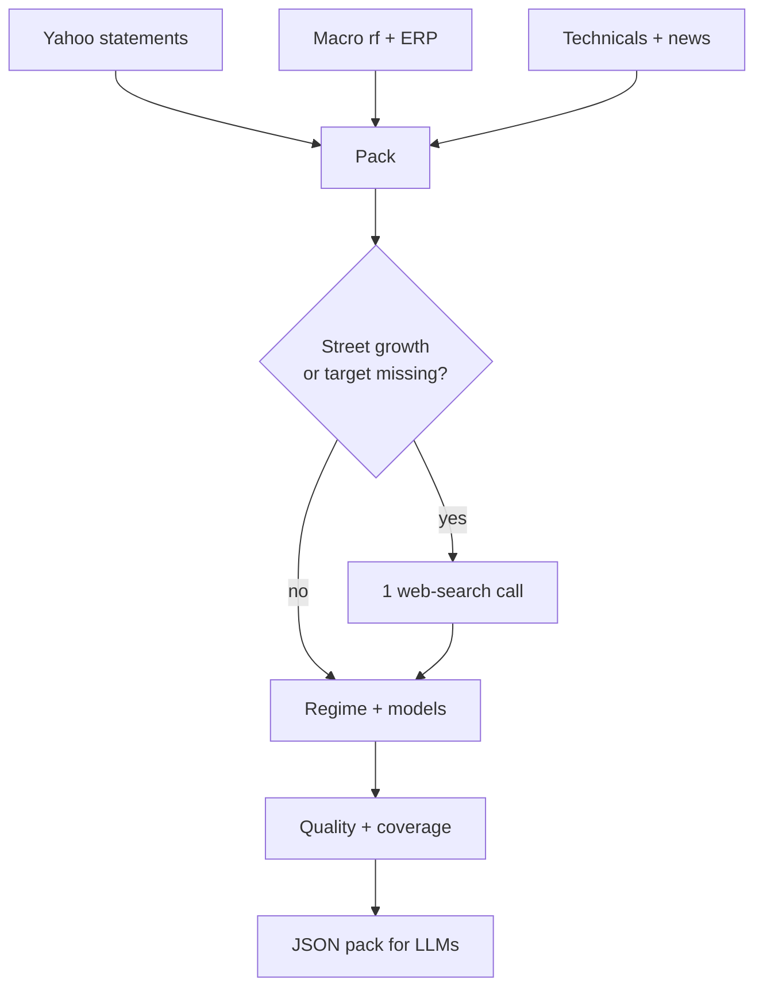
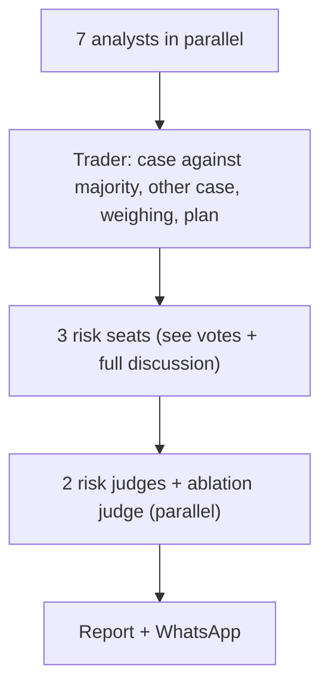

# financial-analysis-agent — design note

Detached research pipeline. Trigger it; it gathers numbers, values them with
formulas, then an LLM committee **interprets** the pack. The LLM does not
do arithmetic. Education only — not financial advice.

**Trigger:** `analyze <TICKER>` (WhatsApp / workspace agent), or

```
python pipeline.py TICKER [--horizon-months N] [--no-whatsapp]
```

**Output:** `reports/<TICKER>-<UTC>.md`, plus an optional WhatsApp summary.
Failures send one error line and stop (no retries). Holding period defaults to
**12 months forward**; the user can pass 1–60 (`analyze QQQ 6`). It is an
input, never a model output.

**Second trigger:** `macro` (no ticker) runs a standalone Fed policy / net
liquidity / inflation / real yields / growth-recession / financial
conditions / dollar-FX / event-calendar scan and turns it into a tech-ETF
tilt and a gold tilt (add / hold / wait), same detach/reply contract, smaller
committee (~5 calls). `analyze <TICKER>` also layers this same regime read
into every ticker report (see Layer 0) — `macro` on its own is for reading
the regime without tying it to one instrument.

---

## Process flow (narrow — paste each block separately in Notion)

Notion mermaid breaks if a graph is wide. Use **three stacked charts**, not
one. In Notion: `/code` → language `mermaid`.

### 1. Launch



### 2. Data then valuation



### 3. Committee



### Same flow as a list (if mermaid still wraps)

1. `analyze TICKER` → script replies → `pipeline.py` detaches
2. Cursor client + data pack (Yahoo, macro, tape, news)
3. Optional web search if growth or Street target is missing
4. Regime → models → quality → coverage → JSON pack (incl. cached macro tilt)
5. Seven analysts (parallel, text-only)
6. Trader argues both cases (against the analyst majority first) and commits to a plan
7. Three risk seats → two risk judges + ablation judge
8. Write report, send summary (holding period = user input, default 12 months)

**~14 model calls** (plus web-search lookups when needed) on Grok 4.7 Medium Fast by default. 360s each (same-input calls swing from ~40s to >240s under parallel load; a timed-out call is abandoned, not waited on). 30 min budget. Debate and risk-seat turns are asked for ≤300 words and hard-truncated at 3,000 chars (the model sometimes ignores word caps), so each next seat's input stays bounded.

---

## Design contract

| Rule | Why |
|---|---|
| LLM never does math | Numbers stay testable and cited |
| Missing field = `None` | Silent zeros would fake a cheap stock |
| Model cannot run → exclude + reason | Bad inputs do not enter the blend |
| Street target is display-only | Consensus is a check, not a crutch |
| Reverse-DCF leads the report | Falsifiable; dollar blend is context |
| Horizon = user input (default 12 months) | The user owns the holding period; the risk judge cannot shorten it |

---

## Layer 0 — Macro regime

**Contribution:** a rules-based read on whether the top-down backdrop
(Fed policy, liquidity, inflation, real yields, growth/recession risk,
financial conditions, dollar) currently favors adding to tech-ETF or gold
exposure — the thing a casual trader actually asked for ("is now a good
time to buy EQQQ / gold"), kept separate from any one instrument's
fundamentals so a stock-picking signal and a macro-timing signal never get
blended into one number.

**Honest limit, stated once:** macro timing is weak over a multi-month
holding period. The tilt is for avoiding bad entries and sizing (DCA pace),
not calling bottoms or tops — every downstream prompt and report repeats
this rather than letting confidence creep in silently. `macro-backtest`
(below) measures how weak, per ticker and horizon, instead of asserting it.

### Data (`macro.py`) — keyless, never fatal

| Source | Feeds | Ground |
|---|---|---|
| FRED (`fred_*` helpers) | Fed balance sheet (WALCL), reserves (WRESBAL), reverse repo (RRPONTSYD), TGA (WTREGEN), core PCE/CPI (PCEPILFE, CPILFESL), breakevens (T10YIE, T5YIFR), unemployment + Sahm rule (UNRATE, SAHMREALTIME), claims (ICSA), yield curve (T10Y2Y), HY spread (BAMLH0A0HYM2), real 10y (DFII10), broad dollar index (DTWEXBGS) | Official Fed data API, keyless CSV endpoints. Fetched via `data.D._yf_session()` (curl_cffi impersonation) — plain `urllib` gets bot-blocked on this network, live-checked |
| federalreserve.gov | Latest + previous FOMC statement text, meeting calendar | Scraped HTML; statement text is the primary source for the redline and the target-range parse |
| Yahoo (`ZQ=F`, `QQQ`, `GC=F`) | Fed funds futures → implied policy rate; QQQ history for the net-liquidity correlation check | Same feed the rest of the pipeline uses |

Every fetch returns `None` + a `_source`/`reason` on failure rather than
raising — one flaky series (e.g. a FRED outage) degrades coverage, it never
kills the run. `build_macro_pack()` assembles all of the above into one
dict, timestamped `as_of`.

### Rules (`macro_rules.py`) — deterministic, no LLM

Eight angles (`policy_path`, `liquidity`, `inflation`, `real_yields`,
`growth_recession`, `financial_conditions`, `dollar_fx`, `event_calendar`),
each a named-threshold function that either resolves to a label + tech/gold
impact (`supportive` / `neutral` / `headwind`) or excludes itself with a
reason (mirrors `valuation.py`'s "no math surprises, no silent guess"
contract). `scorecard()` aggregates these plus a coverage ratio;
`regime_and_tilt()` nets supportive vs headwind per asset class into
`add` / `hold` / `wait` — tech and gold get **independent** tilts from the
same angles because they often diverge (a recession signal is a tech
headwind but a gold tailwind). Below 50% coverage the tilt is forced to
`hold` with a "too thin to trust" reason, same floor `guardrails.py` uses
for a ticker pack. `fomc_redline()` sentence-diffs the latest statement
against the previous one (`difflib`) so the LLM redline reader sees only
what changed, not 400 words to freely summarize.

### Committee (`agents_llm.run_macro_committee`) — five calls

Redline reader (explains the diff + priced-vs-said policy gap) → fiscal/
trade reader (one `webSearch` call, same unverified posture as the Street-
consensus fetch) → tech judge + gold judge (each explains its precomputed
tilt, citing scorecard numbers, never re-deriving it) → devil's advocate
(names the single weakest angle). None of these five calls sees a full
statement or does arithmetic; they interpret numbers/diffs a deterministic
layer already produced.

### Caching (`macro_storage.py`) + layering into ticker reports

One SQLite table (`reports/macro.sqlite`), latest-wins: a snapshot younger
than 24h is reused instead of re-running ~15 fetches. `analyze <TICKER>`
reuses this same cached snapshot to add a `macro_regime` field to every
ticker's data pack (`data.macro_asset_class`: gold tilt for GC=F and
gold-tracking products such as GLD/IAU/IGLN.L/SGLN.L, tech tilt for
everything else) and gives the committee's macro seat that scorecard — a
busy day of ticker analyses does not repeat the macro fetch per ticker.

Net liquidity = WALCL − WTREGEN − RRPONTSYD. FRED publishes the first two
in millions and RRP in **billions**, so RRP is rescaled ×1000 before
subtracting (`macro.RRP_TO_MILLIONS`); unscaled, RRP was ~1000× too small.

### Backtest (`macro_backtest.py`, `pipeline.py MACRO-BACKTEST TICKER [--horizon-months N]`)

Does the tilt actually predict this ticker? Replays the live
`macro_rules` angle functions and `regime_and_tilt` unchanged at every
month-end since 2006 and measures the ticker's N-month forward return
(default 12) in supportive / mixed / headwind months. No model calls, ~20s.

| Soundness rule | How |
|---|---|
| No lookahead | Every series is fetched once, then shifted by a per-series publication lag (`PUBLICATION_LAG_DAYS`, e.g. core PCE +62d, UNRATE +38d) because FRED dates by observation, not release; each month sees only rows public by then |
| Compare to baseline | Each regime row shows return/hit-rate **vs all scored months**, not raw — a 12m hit rate of 85% means nothing for QQQ where 87% of all months rise |
| Count episodes, not months | Consecutive months in one regime are one episode (gaps ≤3 months merged); a 12m forward window overlaps 11 neighbors. <5 episodes is flagged "too few periods" |
| Two windows | Full (2006+) and recent (2015+, post-ZIRP plumbing) side by side |

Six angles only: `policy_path` (needs the historical fed-funds-futures
curve, no free source) and `event_calendar` (a timing flag, not a regime)
are excluded with
reasons in the report; `financial_conditions` only resolves from 2023.
Accepted tradeoff: values are today's revised FRED vintages, not first
prints (ALFRED vintages would fix it). Output:
`reports/MACRO-BACKTEST-<TICKER>-<N>m-<ts>.md`.

---

## Layer 1 — Data

**Contribution:** everything later is only as good as this pack. Provenance
fields (`*_source`) travel with the numbers so a web-search figure is never
mistaken for a Yahoo or SEC field.

### Yahoo statements + quote

| | |
|---|---|
| **Does** | Income, balance, cash flow; price / cap / shares when crumb works |
| **Adds** | Raw inputs for ReOI, quality scores, coverage |
| **Ground** | Standard retail feed. On this network `quoteSummary` often 401s. Statements and chart usually still work. `fast_info` recovers price/cap/shares only |

**Statement freshness (TTM):** the "current period" prefers trailing-4-quarter
sums (income/cash flow) plus the single latest quarter (balance sheet) over
the last annual filing, which can be close to a year stale by the time it's
read. Prior-period comparisons (Piotroski, Mohanram, CCC, YoY) pair that TTM
against the last full fiscal year — the standard "TTM vs LFY" read, and it
only needs 4 quarters of history rather than 8. Falls back to annual (labeled
`statement_basis`) when quarterly data is too thin; income/cash flow and
balance sheet can fall back independently. Every report prints
`Statements used: <date> (<basis>, N days stale)`.

**SEC XBRL primary (revenue / net income / shares, US filers):** SEC's own
`companyfacts` API becomes the primary source for these three fields —
official, audited, and immune to the quoteSummary crumb/rate-limit issues.
Revenue/net income are rebuilt as a trailing-4-quarter sum the same way as
above: Q1–Q3 are each filing's own discrete-quarter fact (picked by duration,
not the SEC API's `fy`/`fp` fields — a 10-K tags all three of its comparative
income-statement columns with the *same* `(fy, fp)`, so keying on that would
silently pick an arbitrary year); Q4 is `FY_total − Q1 − Q2 − Q3` since a
10-K only reports the full year. Shares come from the latest cover-page
`dei:EntityCommonStockSharesOutstanding`, usually fresher than Yahoo's cached
count. Yahoo stays the fallback for non-US tickers or thin XBRL history, and
a >10% disagreement between the two sources (same threshold as the
marketCap-vs-price×shares check) sets `data_warning` without blocking SEC
from still winning as primary.

### Macro (rf + ERP)

| | |
|---|---|
| **Does** | 10Y from treasury.gov (then `^TNX`, then a constant). Implied ERP from Damodaran (then a constant) |
| **Adds** | Live discount rate for CAPM / WACC. Shown on the report with source |
| **Ground** | Official Treasury curve = high. Damodaran implied ERP = accepted academic series, HTML scrape. Constants are last resort and labeled |

### Computed beta

| | |
|---|---|
| **Does** | `Cov(stock, bench) / Var(bench)` on weekly returns. Bench by suffix (`.L` → FTSE, else SPX) |
| **Adds** | Cost of equity when Yahoo beta is blocked |
| **Ground** | Formula is standard. Not Yahoo’s published beta (window / hedging differ). Better than defaulting every name to 1.0 |

### SEC EDGAR sector / industry

| | |
|---|---|
| **Does** | Ticker → CIK → SIC. Maps finance / real estate only (the regimes that branch) |
| **Adds** | Financial names route to equity-RIM; REITs stay unsupported |
| **Ground** | Official US filings. Foreign listings and ETCs (EQQQ.L, IGLN.L) get nothing |

### Earnings calendar (`fetch_earnings_calendar`)

| | |
|---|---|
| **Does** | Next earnings date + consensus EPS estimate, and the last 4 reported quarters' EPS estimate/actual/surprise%, from Yahoo's public earnings-calendar HTML page |
| **Adds** | `flag_earnings_within_2w` (imminent-print cue for the trader/risk seats) and `flag_recent_earnings_misses` (2 straight misses) |
| **Ground** | A plain unauthenticated HTML scrape (yfinance's `get_earnings_dates`), a different endpoint from the blocked quoteSummary crumb — so this stays free and structured (no LLM) even on runs where growth_est/eps_fwd/analyst_target need the web-search fallback below. No free source publishes a true 90-day *estimate-revision* history (that's a paid IBES/Zacks product); the web-search consensus call below best-effort asks for a qualitative up/down/flat read instead, tagged unverified like its other fields |

### Street consensus web search

| | |
|---|---|
| **Does** | One Cursor call with `webSearch`. Prefer stockanalysis / finviz / TipRanks. Rejects replies with no real URLs. Up to 5 named recent calls (firm required), plus a best-effort qualitative 90-day EPS-revision direction (up/down/flat) |
| **Adds** | 5y EPS growth (can feed AEG) + mean/median target + recent named desks + revision direction. **Never** overrides a real Yahoo value. Target stays out of fair value |
| **Ground** | Weakest data path: LLM-summarized. Growth and median have matched live pages; analyst **count** differs by vendor (S&P Global vs TipRanks windows). Revision direction is `null` unless the source states it explicitly — never inferred from the target/growth number. Tagged `unverified` |

### Technicals + news

| | |
|---|---|
| **Does** | SMA, RSI, MACD, 52w, vol; short headline list |
| **Adds** | Timing / tone for technical and sentiment seats. Headlines are **data only** (prompt-injection posture) |
| **Ground** | Tape from the same chart endpoint. Headlines are noisy and can be stale or generic (seen on IGLN.L) |

### Personal portfolio (`portfolio.py`, optional)

| | |
|---|---|
| **Does** | Reads hand-edited `portfolio.yaml` (holdings as `shares` or base-currency `value`, cash, optional target weights; template `portfolio.yaml.example`), live-prices it, and adds `pack.portfolio`: weight per holding, cash %, this ticker's existing weight, HHI concentration |
| **Adds** | Trader and risk seats size against what you **already hold** — "add 4%" on top of a 35% position is a different call than a fresh 4% |
| **Ground** | Opt-in: no file means `portfolio: null`, not an error. No FX layer — cross-currency holdings go in as pre-converted `value`. HHI over %-weights (cash counted as a position) instead of a fragile top-N cutoff |

---

## Layer 2 — Deterministic valuation

**Contribution:** the only place “fair value”, implied growth, and quality
scores are born. Golden-tested. LLM may argue about them; it may not
recompute them.

Basis: Penman / residual income — value anchors on the book, not an ad-hoc
terminal multiple. Fade is **conservative**, so high-ROIC compounders often
screen “cheap-model / rich-tape” (AAPL, TSLA). That is why the report leads
with implied growth, not the dollar blend.

### Regime router

| Regime | When | Models |
|---|---|---|
| mature-profitable | positive NOPAT | ReOI, reverse DCF, AEG, owner earnings |
| financial | sector contains “financial” | equity RIM, reverse DCF, AEG |
| growth-unprofitable | NOPAT ≤ 0 | reverse DCF, AEG |
| distressed | NOPAT ≤ 0, shrinking sales, Z < 1.81 | reverse DCF only |
| etf | ETF / fund / index | none |
| unsupported | REIT | none |

**Ground:** routing is mechanical from quote type / sector / NOPAT / Z. If
Yahoo + SEC both miss sector, a bank can be mis-routed. IGLN.L showed the
failure mode: no statements → leftover `mature-profitable` label with 7%
coverage. Analysts are told to treat that as “no view,” not a thesis.

### Point models

| Model | Adds | Ground |
|---|---|---|
| **ReOI** | Operations value: NOA + PV of residual operating income, faded toward WACC | Textbook. Highest ensemble weight (0.5). Golden-tested. Fade makes wonderful businesses look expensive |
| **Equity RIM** | Same idea on book equity + cost of equity | For banks (NOA/WACC ill-defined). Same literature family |
| **AEG** | P/E-style: capitalized forward earnings + abnormal growth | Needs `eps_fwd` + growth. Growth may be web-search. Excludes itself if those are missing |
| **Owner earnings** | Buffett-style cash earnings, 25% margin of safety | Conservative cash cap. Simple; not a full DCF |

Weights are **chosen, not fit**. `backtest.py` can replace them with
inverse-error weights after a real walk-forward — that is not on the live
path yet.

### Reverse DCF (report headline)

| | |
|---|---|
| **Does** | What FCF (or earnings) growth the **current price** already implies |
| **Adds** | Falsifiable claim: “price needs 31%/yr vs 1.8% history” |
| **Ground** | Solver residual is checked. Still uses WACC and a stage structure. Stronger as a stretch test than as a dollar target |

### Ensemble dollar FV (context)

Weighted average of applicable **point** models only. Reverse DCF has no
point value. ±1% rate band + Monte Carlo p10–p90 (beta / ERP / fade /
terminal g).

**Ground:** internally consistent, not a market forecast. Treat as “what
*this* conservative kit prints,” not liquidation value. Street mean is
shown next to it and **never blended in**.

### Own-history anchors (`anchors.py`, model-free)

| | |
|---|---|
| **Does** | Percentile-ranks today's P/S, EV/FCF, and reverse-DCF implied growth against the ticker's **own** trailing 10y (rolling-TTM SEC XBRL revenue/FCF + Yahoo daily price + SEC `dei` share counts). ETFs/funds get a price-percentile proxy instead (no free historical index forward-P/E series exists) |
| **Adds** | A second anchor next to the fade-based ensemble above, one that never re-derives “fair value” — just “is this multiple/growth rate rich or cheap for *this name*, historically” |
| **Ground** | Every point is real and sourced, no LLM math. US equities only (needs a resolvable SEC CIK); needs ≥ 8 resolved quarters (2y) or reports n/a rather than a percentile nobody should trust. Named simplification: net debt (EV) and WACC (growth solve) are held at **today's** value across the whole lookback window — both move far slower than price/revenue/FCF, and a fully time-varying reconstruction would need several more non-standardized XBRL balance-sheet tags for little marginal accuracy in a rank that only cares about relative position |

### Signal base rates (`base_rates.py`, model-free)

| | |
|---|---|
| **Does** | For the six discrete tape signals the technical seat is asked to read (golden/death cross, RSI oversold/overbought zone-entry, MACD bull/bear cross), the forward hit rate + n over the user's holding period (default 12 months; N months = N×21 trading days) from the **last times this exact signal fired on this ticker** over its own trailing ~15y of daily price |
| **Adds** | A sanity check for a live technical signal ("this fired 7 times before, 71% of the time it was up a year later") instead of the technical seat asserting pattern-reliability from memory |
| **Ground** | Every event and forward return is read straight off Yahoo daily closes, no LLM math. Events are zone/cross **entries** (this-bar-true, prior-bar-false), not persistent-day counts, so one long RSI<30 episode counts once, not for every day it holds. Hit rate uses the same Wilson 95% CI as `track_accuracy.py` and is marked untrusted below n=3. Named simplification: hit = forward return **> 0 absolute**, not benchmark-relative — a signal that only rode a long bull market (live-checked: AAPL's "death cross" hit rate is 86% over the last 15y, for exactly this reason) still counts as a "hit" here; the macro tilt above already supplies that broader context, and a benchmark-relative version of six signals is a heavier feature for what is meant as a quick sanity check, not the report's headline. Applies to any ticker with price history, ETFs/commodities included — no fundamentals regime gate |

### Quality overlay

| Score | Adds | Ground |
|---|---|---|
| Piotroski F | 0–9 earnings / balance improvement | Published; golden |
| Mohanram G | Growth-firm quality (adapted if needed) | Published; golden |
| Altman Z | Distress zone | Classic; not a bank model |
| Beneish M | Manipulation flag; **requires net PPE** | Published; excludes if PPE missing (no silent 0) |
| Accruals | NI vs cash | Simple red flag |
| CCC | DSO + DIO − DPO | Working-capital health |
| Core EBIT | Unusual items vs EBIT | Only if the line exists |
| Buybacks vs FV | Did they retire stock above model FV? | Flag vs **model** FV, not Street |
| ROCE split | RNOA, PM, ATO, FLEV, SPREAD | Penman; SPREAD needs interest expense |
| Coverage | How full the pack is (e.g. 93% AAPL, 7% IGLN) | Meta-signal: do not size a 7% pack |

---

## Layer 3 — LLM committee

**Contribution:** turn the pack into a **decision** (direction, size,
invalidation) with disagreement on the record. All analysis calls use
`tools=[]`. Only the optional consensus fetch may browse.

**Ground:** interpretation, not a data vendor. A cited pack number is
stronger than an uncited adjective. Judge is told to discount uncited
claims. Personas can still overweight the fade-model dollar gap (seen on
AAPL/TSLA). Read the trader's bull/bear sections, not only the emoji.

| Seat | Adds | Ground |
|---|---|---|
| Fundamental | Quality + trajectory from F/G/Z/M and statements | Bound to pack scores |
| Valuation | Implied growth, exclusions, bands; warned that fade screens compounders rich | Bound to model outputs |
| Technical | Trend / momentum / range + own-history signal base rates (`base_rates.py`) | Bound to tape fields |
| Sentiment | Headline tone + momentum | Weakest seat; headlines are untrusted text |
| Buffett | Moat, ReOI spread, owner earnings, margin of safety | Lens, not a new model |
| Burry | Accruals, Beneish, Z, implied vs history | Lens, not a new model |
| Macro | Regime scorecard + tilt (Layer 0); primary for ETFs, secondary context for single stocks | Bound to `macro_rules.py` output, not re-derived |

**No separate debate.** Across 18 saved reports the Bull/Bear rounds never
flipped the analyst majority's direction, and they were five sequential
calls - the slowest, most timeout-prone stage. The trader now writes the
case **against** the analyst majority first (a tie counts as bearish), then
the other case, a weighing, and the plan; a unanimous panel gets an
explicit skeptic instruction in place of the old devil's advocate. Risk
seats and both risk judges also see the analyst votes, and each risk seat
sees every earlier risk turn in full (each turn is already capped).

**Risk:** trader proposes size 0–10% and invalidation → aggressive /
conservative / neutral → risk judge. **The holding period is the user's
input** (default 12 months), stated in the trader and judge prompts; the
judge's JSON has no horizon field, so no seat can change it.

**Honest-committee checks (Phase 3):** the risk judge runs **twice** on
identical input, in parallel (the SDK has no seed/temperature, so run-to-run
variation is the probe). Agreement keeps the lower conviction and smaller
size; disagreement takes the more cautious signal (AVOID < HOLD < BUY) and
`guardrails.py` caps conviction at 50. A third **ablation** judge sees the
pack with the dollar fair value removed, the trader/risk text, and the
valuation seat's vote; if its call differs, the report says "decision rests
on the valuation model" and conviction is capped at 50. The judge also states
its invalidation as a checkable close (`Invalidation level: close below 294.00`).
Cost: three parallel calls instead of one, so wall time barely moves.

---

### What changed since last run

Every repeat-ticker report opens with a deterministic diff against the previous
saved pack (price, fair value, implied growth, Street target, fwd EPS, own-history
percentiles, RSI, data coverage, macro tilt) plus the previous decision. The macro
report lists which angle labels and tilts flipped since the previous snapshot. No model calls.

---

## What the report is claiming

1. **Headline:** what growth the price implies vs history (falsifiable)
2. **Context:** conservative ensemble $ vs price (often a huge gap on
   compounders — that is the fade, not a 1-week trade)
3. **Street:** S&P-style consensus + a few named recent calls (not the
   full panel)
4. **Quality:** is the business durable / clean
5. **Decision:** BUY / HOLD / SELL, conviction, size, holding period (user input, default 12 months),
   invalidation

IGLN.L is the clean ETF/ETC case: models exclude themselves, coverage 7%,
HOLD 0%. SpaceX cannot run (no listed price).

---

## Off the live path

| Tool | Role | Ground |
|---|---|---|
| `backtest.py` | Walk-forward on old statement columns; can recalibrate weights / fade | Exists; not auto-run on `analyze` |
| `track_accuracy.py` | `track [TICKER]` command (`pipeline.py TRACK`): plain-English summary + `TRACK-<ts>.md`. Score old reports after 30 / 90 / 180 / 365 days, incl. `MACRO-*.md` tilts (scored vs QQQ / GC=F, kept out of the ticker hit rate). Also checks whether each report's stated invalidation level was breached by a daily close inside its holding period (older reports: "not checkable"), and rebuilds a **paper book vs DCA** per ticker | Empty until reports age in |

**Paper book vs DCA:** both books start with the same cash at the ticker's first report. The agent book follows the reports (BUY at size s% invests s/10 of the starting cash, 10% being fully invested; AVOID sells everything; HOLD does nothing). The DCA book buys 1/12 of the cash monthly for 12 months from the first report regardless. Both are valued at today's price, idle cash earns nothing, and the books are recomputed from saved reports + prices on every run (no stored state to drift). Needs reports that print `Price at report` (the earliest reports lack it).

---

## Files

| File | Role |
|---|---|
| `finance-agent.sh` | Detach + immediate reply (`<TICKER> [MONTHS]`, `macro`, `track [TICKER]`, or `macro-backtest <TICKER> [MONTHS]`) |
| `pipeline.py` | Orchestrate pack → LLMs → report / WhatsApp; `run_ticker` / `run_macro` / `run_macro_backtest` |
| `data.py` | Fetch + fallbacks |
| `valuation.py` | Formulas, regime, quality |
| `anchors.py` | Own-history percentiles (P/S, EV/FCF, implied growth; ETF price proxy) |
| `base_rates.py` | Own-history forward hit rates (user horizon) for technical signals (cross/zone-entry events) |
| `changes.py` | "What changed since last run": diff of key pack fields + previous decision for the same ticker; macro angle/tilt flips vs the previous snapshot |
| `portfolio.py` | Optional `portfolio.yaml` holdings → weights, existing exposure, HHI for trader/risk sizing |
| `macro_backtest.py` | Point-in-time monthly replay of the macro tilt vs a ticker's forward returns |
| `macro.py` | Keyless FRED / Fed / Yahoo macro fetchers |
| `macro_rules.py` | Deterministic angle labels, scorecard, tech/gold tilt, FOMC redline |
| `macro_storage.py` | 24h macro-snapshot SQLite cache |
| `agents_llm.py` | Cursor committee (incl. macro seat + standalone macro committee) |
| `backtest.py` / `track_accuracy.py` | Offline measurement |
